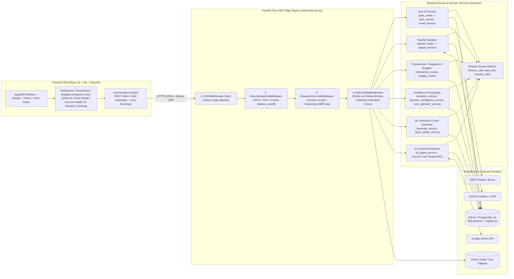

# Finova AI — System Architecture (Baseline & Target Boundaries)

**Project Root:** `D:\Myprojects\finova`  
**Backend Stack:** Python 3.12+, FastAPI, SQLAlchemy 2.x ORM, Pydantic v2, httpx, scikit-learn, numpy, redis-py  
**Frontend Stack:** React 18, TypeScript, Vite 6, Tailwind CSS 3, Recharts, Lucide React  
**Persistence:** SQLite (`finova.db` in local dev) / PostgreSQL (staging & production)  
**External Integrations:** PayPal Sandbox REST API v2, Google Gemini API, Optional SMTP Relay, Redis (distributed rate limiting)

---

## 1. High-Level Request & Component Architecture

---

## 2. Clean Layer Boundaries (Target Phase 1 Architecture)

1. **Frontend Presentation Layer (`frontend/src/`)**:
   - Stateless UI components and typed views (`views/`, `components/`) consuming explicit API data via `services/api.ts`.
   - Zero fabricated financial fallback figures or synthetic fallback charts on authenticated views; explicit loading, empty, unauthenticated, and backend-error banners.
   - Accessible light-first fintech design system (`#F8FAFC` background canvas, `#FFFFFF` elevated cards, subtle `#0070BA` / `#003087` accents).

2. **API Transport & Security Layer (`backend/main.py`, `backend/routes/`)**:
   - Pure ASGI middleware enforces security headers, CORS, strict `Content-Length` + streaming payload size caps, and Redis distributed rate limiting consistently across every HTTP status code (`200`, `400`, `413`, `429`, `500`, `503`).
   - Route handlers perform strict Pydantic request/response validation, pagination/filter parameter parsing, JWT/RBAC verification (`get_current_user`, `resolve_scoped_user_id`), and HTTP status mapping—never raw SQL or duplicated domain formulas.

3. **Shared Financial, Temporal & Security Utilities (`backend/services/shared_utils.py` — planned Phase 1)**:
   - Single authoritative implementation of:
     - `parse_transaction_datetime()` (replaces 3 divergent `_parse_date` implementations).
     - `Decimal` PayPal fee & multi-currency normalization (`USD`, `EUR`, `GBP`, `CAD`, `AUD`, `JPY` zero-decimal rules, US vs cross-border ISO-2 country normalization).
     - PCI-DSS PAN/token log & prompt redaction (`redact_sensitive_text`).

4. **Business, ML & AI Services (`backend/services/`)**:
   - **Financial & Ledger Engine:** Atomic DB transactions (`Session`), `Decimal` precision persisted via `Numeric(12, 2)`, budget vs actual tracking, CSV export.
   - **ML Service (`anomaly_service.py`):** Thread-safe stateless per-evaluation `IsolationForest` / `LocalOutlierFactor` fitting (or immutable snapshotted model artifacts) with deterministic model version metadata and offline benchmark metrics.
   - **AI & RAG Service (`ai_agent_service.py`):** Per-tenant retrieved context chunks (ledger metrics, recent matching transactions, budgets, PayPal policy snippets, scam history) ranked deterministically, sanitized against prompt injection, sent with conversation history & timeout guardrails to Gemini, and logged with token/latency telemetry (`ai_usage_logs`).

5. **Infrastructure & Migrations (`backend/database.py`, `backend/migrate.py`)**:
   - Strict separation between pre-startup migration (`python migrate.py` using transaction-scoped PostgreSQL advisory locks) and worker startup (`verify_database_ready()` read-only probe inside `lifespan`).

---

## 3. Current Database Tables vs Phase 4 Target Additions

**Current Tables (`models/user.py`, `models/transaction.py`):**
- `users` (`id`, `email`, `hashed_password`, `full_name`, `business_name`, `is_active`, `role`, `token_version`, `reset_token`, `reset_token_expires_at`, `created_at`, `updated_at`)
- `security_audit_logs` (`id`, `user_id`, `action`, `ip_address`, `user_agent`, `status`, `details_json`, `created_at`)
- `webhook_events` (`id`, `event_type`, `resource_id`, `status`, `payload_snippet`, `created_at`)
- `revoked_tokens` (`jti`, `user_id`, `expires_at`, `revoked_at`)
- `paypal_orders` (`order_id`, `user_id`, `amount Numeric(12,2)`, `currency`, `status`, `created_at`, `updated_at`)
- `transactions` (`id`, `paypal_order_id`, `paypal_capture_id`, `user_id`, `customer_name`, `customer_email`, `amount`, `currency`, `status`, `date`, `estimated_fee`, `actual_fee`, `net_amount`, `payment_method`, `country`, `risk_score`, `risk_level`, `is_anomaly`, `anomaly_reason`, `data_source`, `raw_paypal_payload`, `created_at`)
- `scam_audit_logs` (`id`, `user_id`, `target_type`, `input_snippet`, `risk_score`, `risk_level`, `confidence`, `indicators_json`, `safe_actions_json`, `safe_inspection_json`, `created_at`)

**Planned Additive Schema Enhancements (Phase 4, preserving all existing data):**
- Additive columns on `transactions`: `category` (`String(64)` nullable/default `"Uncategorized"`), `notes` (`Text` nullable), `txn_type` (`String(16)` default `"income"`), `updated_at` (`DateTime` nullable), plus decimal migration strategy / precision-safe checks.
- New tables with indexed `user_id` foreign keys (`users.id`):
  - `categories` (`id`, `user_id`, `name`, `kind`, `color`, `created_at`)
  - `budgets` (`id`, `user_id`, `category`, `limit_amount Numeric(12,2)`, `currency`, `period`, `created_at`, `updated_at`)
  - `ai_usage_logs` (`id`, `user_id`, `intent`, `provider`, `model_name`, `latency_ms`, `prompt_chars`, `response_chars`, `used_fallback`, `created_at`)

